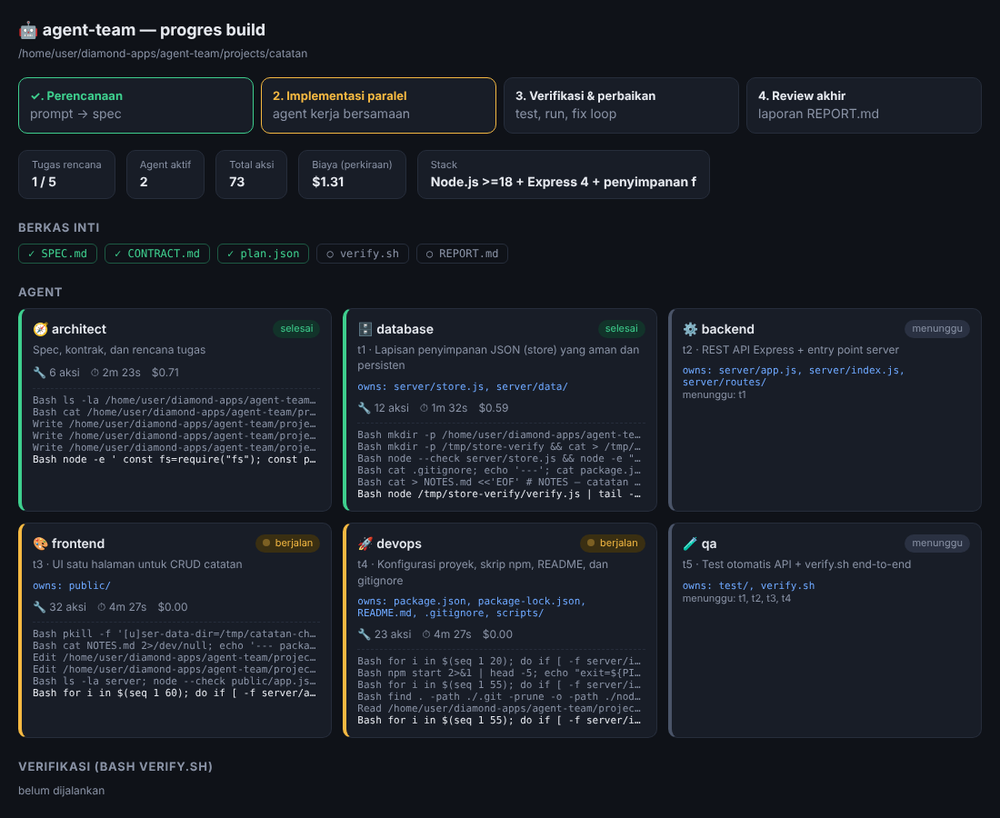

# agent-team — tim AI multi-agent pembuat aplikasi

Dari satu prompt → aplikasi jalan + test lulus, tanpa campur tangan manusia.

## Alur

```
prompt ─▶ [architect] ─▶ SPEC.md + CONTRACT.md + plan.json
                              │
              gelombang paralel (sesuai dependsOn, maks --parallel)
        ┌───────────┬─────────┴──┬───────────┐
   [backend]   [frontend]   [database]   [devops]   ← tiap agent hanya boleh menulis di "owns"-nya
        └───────────┴─────────┬──┴───────────┘
                           [qa]  → test + verify.sh
                              │
              loop: bash verify.sh ──gagal──▶ [debugger] ─┐
                              ▲───────────────────────────┘  (maks --max-fix)
                              │ lulus
                          [reviewer] → REPORT.md
```

Kunci agar benar-benar otonom dan tidak saling merusak:

1. **Kontrak dulu** — `CONTRACT.md` memungkinkan frontend & backend dikerjakan bersamaan.
2. **Kepemilikan file ditegakkan hook** (`PreToolUse`), bukan sekadar prompt → tidak ada konflik tulis paralel.
3. **Verifikasi deterministik** — orkestrator sendiri yang menjalankan `verify.sh` (install → build → test →
   start app → smoke test curl). Agent tidak bisa mengklaim "sudah jalan" tanpa bukti.
4. **Debugger dilarang melemahkan test**; tiap fase di-commit git di workspace sehingga bisa di-rollback.

## Pakai

```bash
cd agent-team && npm install
```

```bash
DEEPSEEK_API_KEY=sk-... node src/run.js "Aplikasi todo dengan login, REST API, dan UI web"
```

Opsi: `--resume` (lanjutkan run yang terhenti: `node src/run.js --resume --out projects/<nama>`) · `--out dir` · `--parallel 4` · `--max-fix 5` · `--budget 5` (USD per agent) · `--model <id>`

Hasil ada di `projects/<nama>/` (SPEC, kode, `verify.sh`, `REPORT.md`, log per agent di `.team/logs/`).

## Dashboard progres (live)

```bash
node src/dashboard.js projects/<nama> 4000
```

Buka `http://localhost:4000`: fase, kartu tiap agent (status, aksi terakhir, waktu, biaya), hasil `verify.sh`, dan
riwayat commit. Membaca log di `.team/` sehingga bisa dibuka kapan saja, termasuk setelah run selesai.

Dashboard "Kantor Virtual Nexora": denah ruangan per peran, meja per agent, detail tugas, aktivitas, berkas, dan hasil verifikasi.



## Provider

- **DeepSeek (default bila `DEEPSEEK_API_KEY` ada)**: SDK diarahkan ke `https://api.deepseek.com/anthropic`
  (endpoint kompatibel-Anthropic), model `deepseek-chat`. Ganti dengan `--model deepseek-reasoner` bila perlu
  (lebih lambat; cocok hanya untuk architect/debugger). Base URL bisa diganti via `DEEPSEEK_BASE_URL`.
- Anthropic: set `ANTHROPIC_API_KEY` tanpa `DEEPSEEK_API_KEY`.
- Catatan: angka biaya & `--budget` dihitung SDK dengan tarif Claude, jadi tidak akurat untuk DeepSeek;
  pantau pemakaian di dashboard DeepSeek. Tool `WebSearch` tidak dipakai karena berjalan di sisi Anthropic.

## Peringatan

Default: mode `dontAsk` — hanya tool di daftar tiap peran yang boleh jalan (termasuk `Bash`, jadi tetap bisa menjalankan
perintah shell). `AGENT_TEAM_BYPASS=1` melewati semua izin. **Jalankan tetap hanya di container/VM/sandbox**. Tetapkan `--budget` agar biaya terkendali.

## Menambah agent

Tambahkan peran di `src/agents.js` (mis. `security`, `designer`, `docs`); arsitek otomatis bisa memakainya jika
namanya ditambahkan ke daftar role di prompt arsitek dan ke validasi di `src/run.js`.
